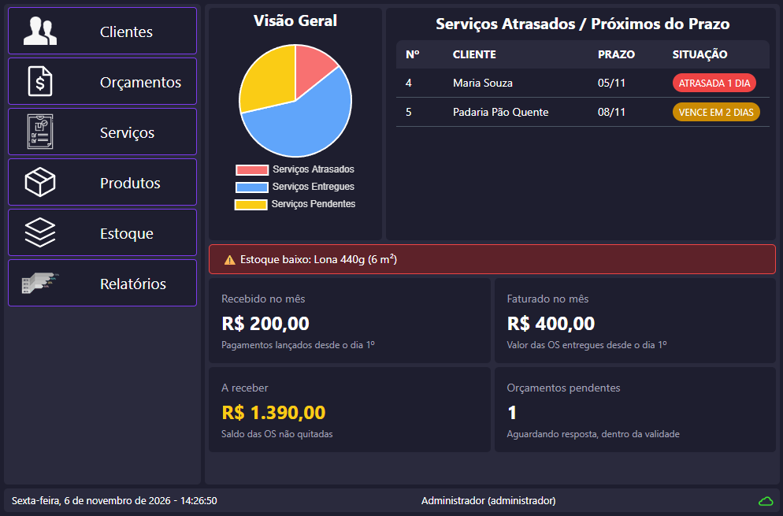
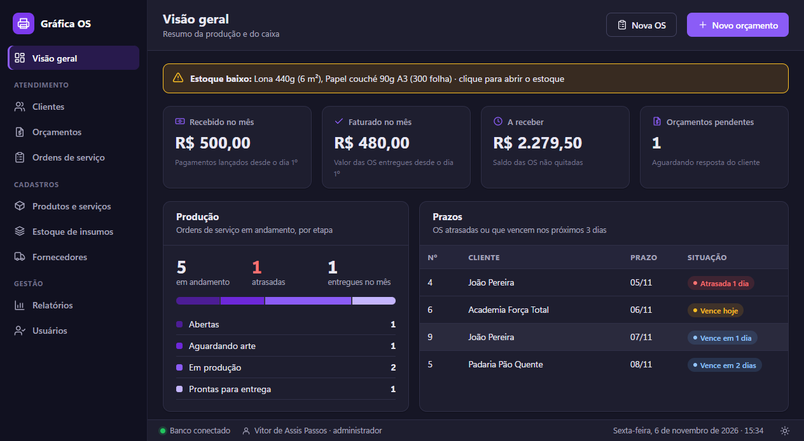
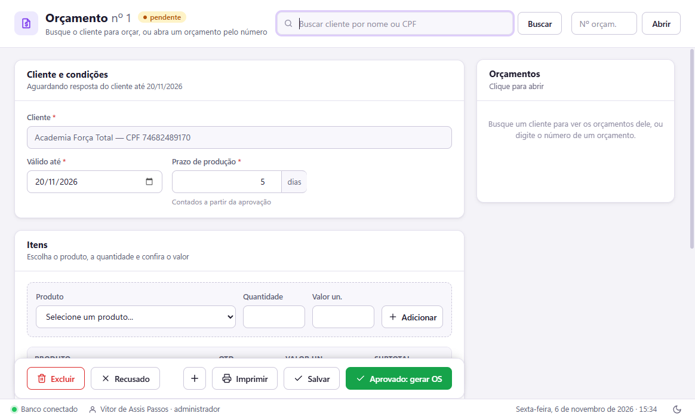
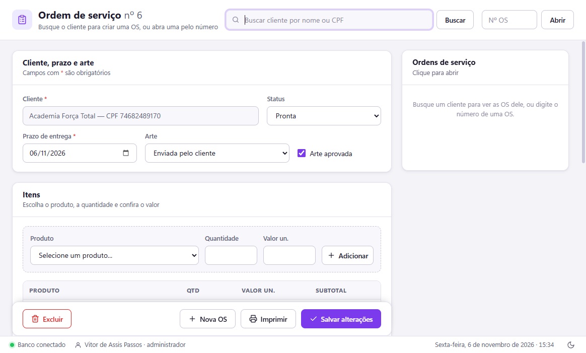
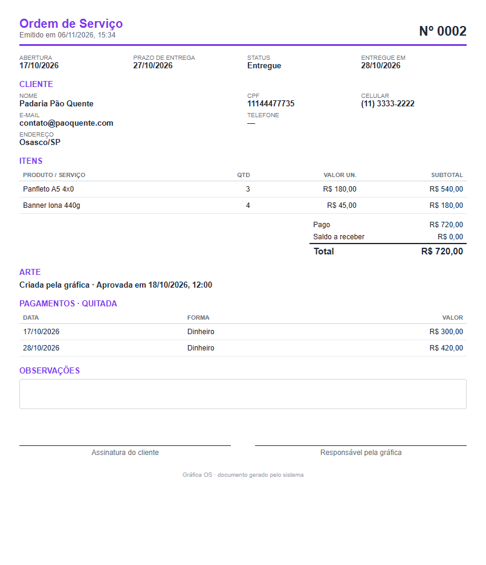
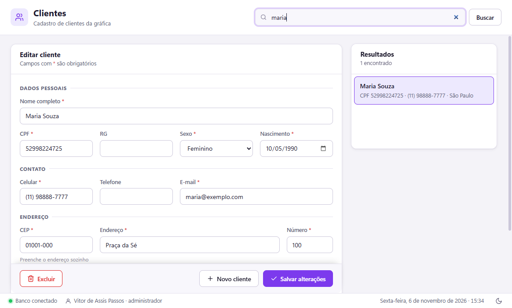
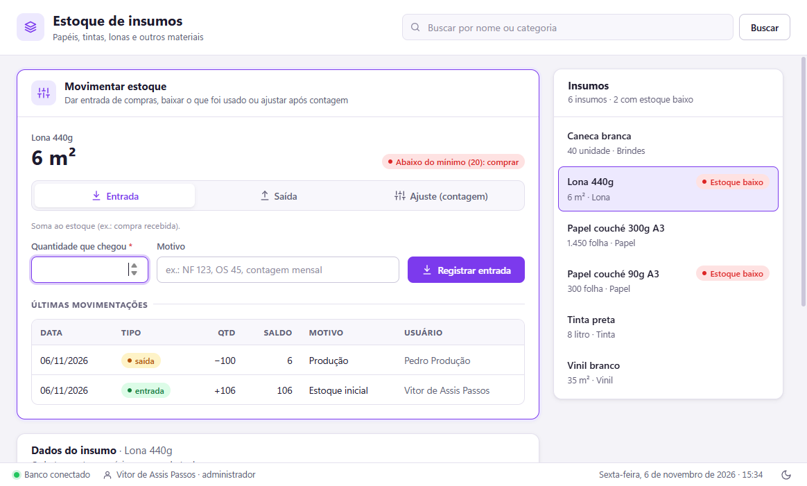
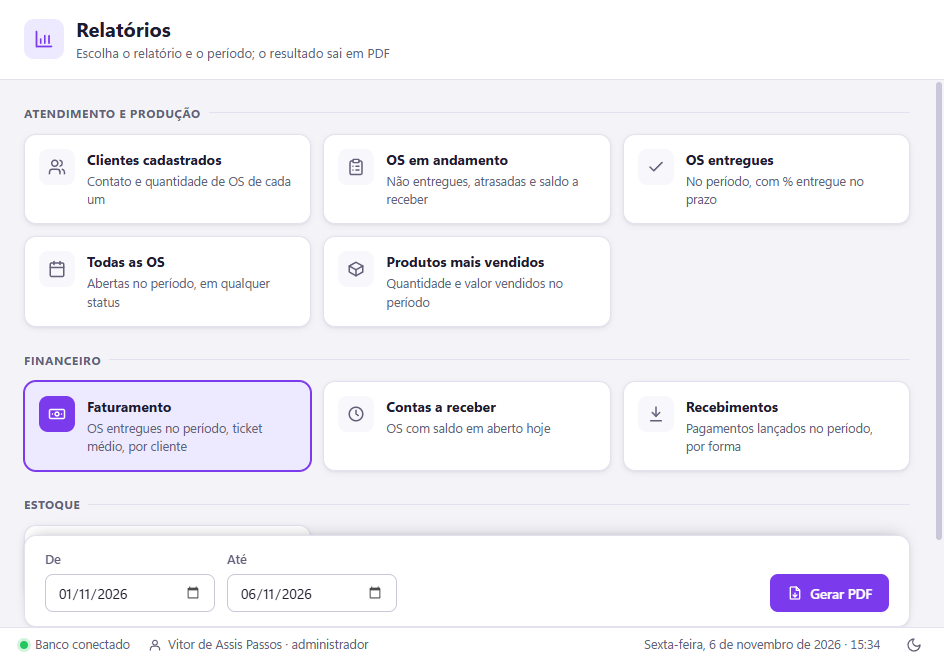
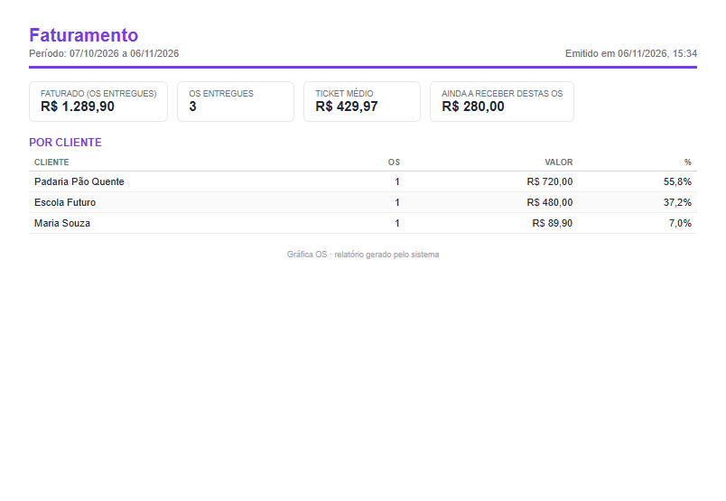
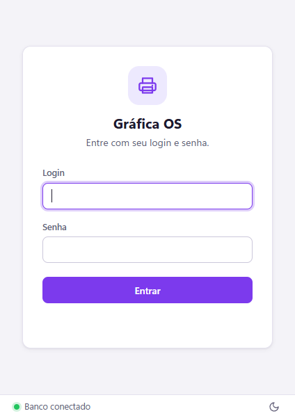

# Gráfica OS 🖨️

Sistema para gestão de uma gráfica: orçamentos, ordens de serviço, pagamentos, estoque de insumos e relatórios. Desenvolvido com o framework Electron e o banco de dados MongoDB.

### Tela principal


### Tema escuro


### Orçamentos


### Ordem de serviço


### Ordem de serviço impressa


### Cadastro de clientes


### Estoque de insumos


### Relatórios



### Login


## Funcionalidades

- **Orçamentos** com validade e prazo de produção; ao ser aprovado, vira uma OS automaticamente
- **Ordens de serviço** com número sequencial, itens, prazo, etapas da produção, aprovação da arte e pagamentos (sinal, parcelas e quitação)
- **Impressão em PDF** da OS, do orçamento e de 10 relatórios (faturamento, contas a receber, produtos mais vendidos, estoque, auditoria...), que também saem em **Excel**
- **Backup e restauração** (arquivo cifrado) e **exportação de todos os dados para Excel**, para levar a outro sistema
- **Clientes** pessoa física (CPF) ou jurídica (CNPJ), com o documento cifrado no banco, busca exata por CPF/CNPJ e endereço preenchido pelo CEP
- **Histórico preservado**: busca de OS e orçamentos pelo CPF/CNPJ (mesmo de clientes removidos); cliente com histórico é desativado, não excluído
- **LGPD**: PDF com os dados do cliente, anonimização a pedido, limpeza após 5 anos e registro de auditoria
- **Produtos e serviços**, com unidade de venda (unidade, cento, milheiro, m²)
- **Estoque de insumos** (papel, tinta, lona...) com entrada, saída, ajuste, histórico e alerta de estoque baixo; cadastro de fornecedores
- **Usuários e perfis**: administrador, atendente e produção, cada um vendo só o que pode usar
- **Tema claro e escuro**

## Autor
Vitor de Assis Passos · [@ti-vitor-assis](https://github.com/ti-vitor-assis)

## Pré-requisitos de instalação:
- Windows 10 ou superior
- Banco de dados MongoDB: instalado no computador (gratuito) **ou** na nuvem, pelo MongoDB Atlas

### Instalação do MongoDB:
Acesse o site oficial:
[MongoDB](https://www.mongodb.com/try/download/community)

Baixe o MongoDB Community Server e instale com a opção de "Install MongoDB as a Service" ativada (instalação padrão).

Após instalar, ele inicia automaticamente.

> Prefere o banco na nuvem? Crie uma conta gratuita no [MongoDB Atlas](https://www.mongodb.com/atlas) e copie a string de conexão em *Connect › Drivers*.

### Instalação do sistema Gráfica OS
Em [Releases](https://github.com/ti-vitor-assis/grafica-os/releases) faça o download da última versão (.exe) disponibilizada e execute no computador.

### Primeira execução
1. **Configurar o banco de dados:** na primeira vez, o sistema abre a tela de configuração. Clique em **Usar MongoDB local** (ou cole a string do Atlas), depois em **Testar conexão** e em **Salvar e conectar**.
2. **Criar o administrador:** informe seu nome, login e senha.
3. **Cadastrar a equipe:** em **Usuários**, crie o acesso de cada funcionário com o perfil adequado.

A configuração do banco fica salva neste computador (criptografada) e pode ser trocada depois pelo administrador em **Ferramentas › Configurar banco de dados**.

### Backup
Em **Ferramentas › Fazer backup** o administrador salva um arquivo com todos os dados, cifrado com a chave de segurança do banco. O painel inicial lembra quando o último backup tem mais de 7 dias. Para recuperar, use **Ferramentas › Restaurar backup** (o estado atual é guardado antes, por segurança).

> O backup só abre com a chave de segurança do banco: guarde junto o arquivo de chave (veja abaixo).

Para levar os dados a outro sistema, use **Ferramentas › Exportar todos os dados para Excel**: uma planilha com uma aba por assunto, com CPF/CNPJ legível.

### Mais de um computador na gráfica
Os CPFs/CNPJs são cifrados com uma **chave de segurança** criada no primeiro computador. Para usar o mesmo banco em outro computador:
1. No primeiro, entre como administrador e vá em **Ferramentas › Configurar banco de dados › Exportar chave**, definindo uma senha.
2. No novo computador, configure o mesmo banco e use **Importar chave** com o arquivo e a senha.

> Guarde o arquivo de chave e a senha em local seguro (por exemplo, um pen drive guardado). Sem eles, os CPFs/CNPJs não podem ser lidos.

### Banco de uma versão de teste
Se o banco foi criado por uma versão de teste (antes da 1.0.0), ao abrir a 1.0.0 o sistema o atualiza sozinho: grava um backup cifrado em `%APPDATA%\grafica-os\backups`, cifra os CPFs já cadastrados, retira RG e sexo e liga cada OS e orçamento ao CPF/CNPJ do cliente.

## Perfis de acesso

| Permissão | Administrador | Atendente | Produção |
|---|:---:|:---:|:---:|
| Clientes e orçamentos | ✔ | ✔ | |
| Ordens de serviço | ✔ | ✔ | ✔ |
| Produtos e preços | ✔ | | |
| Relatórios | ✔ | ✔ (sem os financeiros) | |
| Financeiro (faturamento, a receber, recebimentos) | ✔ | | |
| Estoque e fornecedores | ✔ | | ✔ |
| Excluir/desativar registros, anonimizar clientes (LGPD) | ✔ | | |
| Usuários, auditoria, chave de segurança e configuração do banco | ✔ | | |

As permissões são verificadas no processo principal, e não apenas escondidas na tela.

## Privacidade e LGPD

A gráfica é a controladora dos dados dos seus clientes; o sistema ajuda a cumprir a LGPD:

- **Só o necessário:** nome/razão social, CPF/CNPJ e um contato. Endereço e nascimento são opcionais; RG e sexo não são pedidos.
- **CPF/CNPJ cifrado** (AES-256-GCM) no banco, com busca exata por um índice que não revela o número. Listas, relatórios e telas de OS mostram o documento mascarado (`***.982.247-**`); o número inteiro só aparece na ficha do cliente e nos PDFs entregues a ele.
- **Direitos do titular:** em Clientes, **Dados do cliente** gera um PDF com tudo o que está guardado, e **Anonimizar** apaga os dados pessoais a pedido.
- **Histórico:** cada OS e orçamento guarda uma cópia (cifrada) do cliente da época. OS e orçamentos não são excluídos (são cancelados ou recusados) e ficam por 5 anos; depois, **Ferramentas › Limpeza LGPD** apaga os dados pessoais antigos.
- **Auditoria:** quem entrou, cadastrou, consultou a ficha, exportou ou anonimizou, sem guardar os dados do cliente (**Relatórios › Registro de auditoria**).

O texto completo, com um modelo de aviso para o balcão e os termos de uso, está no próprio sistema em **Ajuda › Privacidade e LGPD**.

## Para desenvolvedores

Requisitos: [Node.js](https://nodejs.org/) 20 ou mais recente.

```bash
git clone https://github.com/ti-vitor-assis/grafica-os.git
cd grafica-os
npm install
npm start
```

Na primeira execução, configure o banco pela própria tela do sistema. Se preferir, crie um arquivo `.env` na pasta do projeto (veja o `.env.example`), que tem prioridade sobre a tela:

```env
MONGO_URL=mongodb://127.0.0.1:27017/graficaos
```

| Comando | O que faz |
|---|---|
| `npm start` | Abre o sistema |
| `npm run css` | Gera o `tailwind.css` (rode depois de usar classes novas do Tailwind) |
| `npm run dist` | Gera o instalador do Windows em `dist/` |
| `npm test` | Testes de unidade (modelos, relatórios, segurança, LGPD e migração) |
| `npm run test:e2e` | Abre o app de verdade e testa as telas de ponta a ponta |

**Tecnologias:** Electron, MongoDB com Mongoose, HTML/CSS/JavaScript, Tailwind CSS, bcryptjs e electron-builder.

**Estrutura:**

```
main.js            Processo principal: janelas, menu, login, permissões e IPC
preload.js         Ponte segura entre as telas e o main (window.api)
database.js        Conexão com o MongoDB
src/model/         Modelos do Mongoose
src/views/         Telas (HTML)
src/public/        CSS (app.css com os temas), ícones e scripts das telas
src/print/         Modelos dos PDFs (OS, orçamento e relatórios)
src/reports/       Consultas dos relatórios
src/seguranca/     Criptografia do CPF/CNPJ, arquivo de chave e limpeza do IPC
src/servicos/      Regras de clientes, orçamentos, LGPD, auditoria, backup, exportação e migração
tests/             Testes de unidade e de ponta a ponta
```

## Licença
[MIT](LICENSE)

<hr>

### ☕ Feito com muito café
O Gráfica OS levou semanas de trabalho, muitas delas noite adentro, sempre com uma xícara de café por perto. Ele é gratuito e vai continuar sendo. <br>Se o projeto foi útil para você e quiser colaborar com o próximo café, fique à vontade. Toda ajuda é muito bem-vinda!

#### Chave PIX❖ (aleatória):
~~~txt
0502c518-2027-44f0-91d0-23b152da3684
~~~
*( em nome de Vitor de Assis Passos )*

Uma estrela ⭐ no repositório e o compartilhamento com quem possa precisar também ajudam bastante.

😃 Obrigado pela visita!
